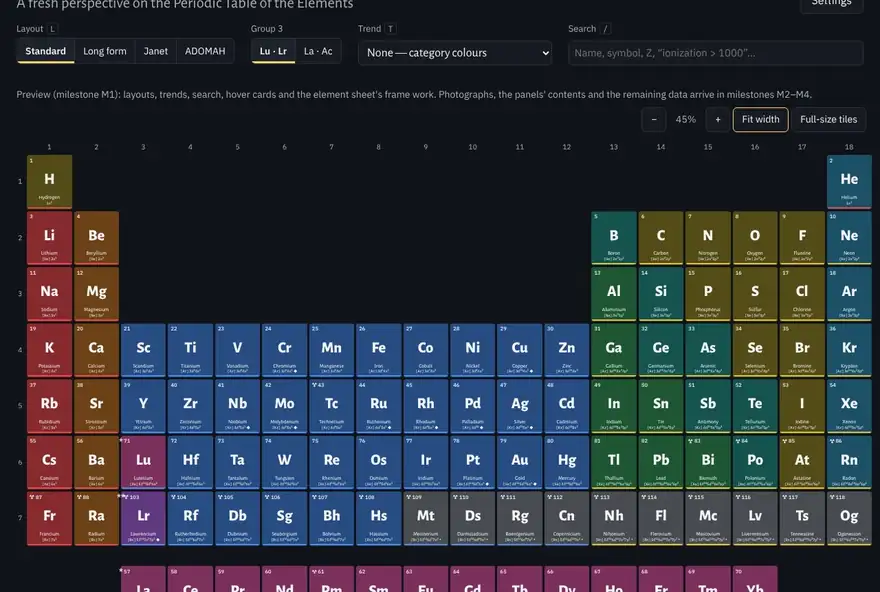
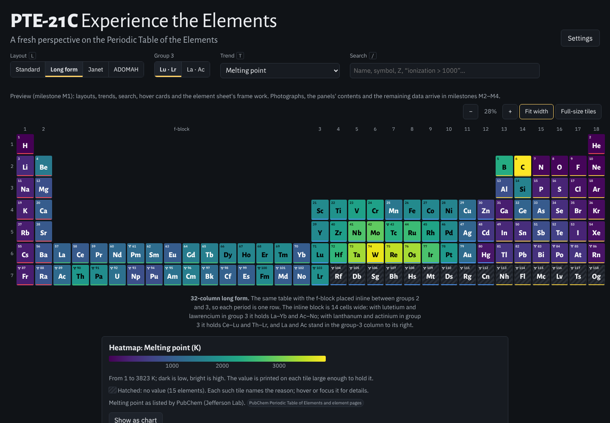
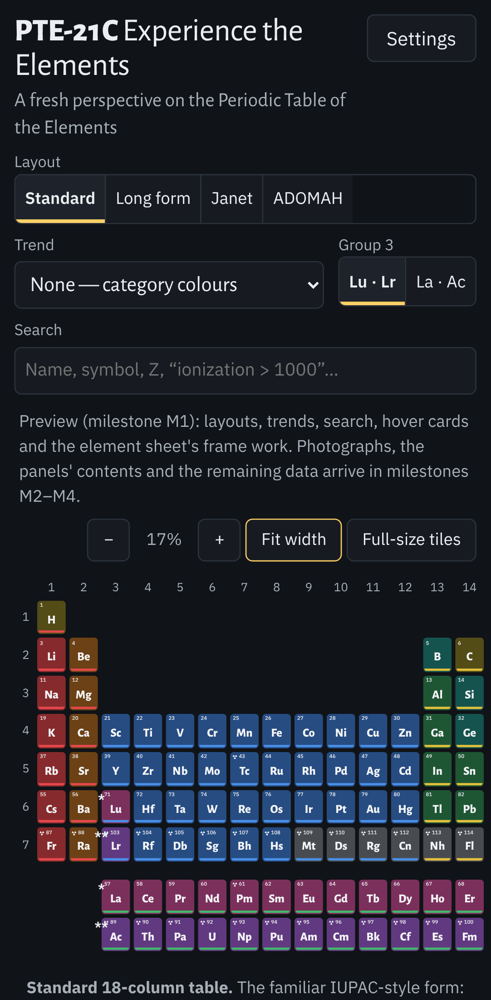

<!-- SPDX-License-Identifier: CC-BY-NC-SA-4.0 -->
# PTE-21C — Experience the Elements

*A fresh perspective on the Periodic Table of the Elements.*

A quantum-aware, photographic periodic table for the web. Every element gets its photographs, its electrons,
its nucleus and its place in the physics of measurement — and **every number on screen has a source**. Where
nothing has been measured, the table says so and says why, instead of showing a plausible guess.

> **Status: milestone M2 (data complete for v0.1).** All 118 elements from real, sourced data, in four
> layouts that morph into one another, with trend arrows, heatmaps and maps, search, hover cards, pinch-zoom,
> credited photographs, a short text per element and an About page showing how complete the data is. The
> eleven panels of the element sheet get their contents in milestones M3–M4. See [STATUS.md](STATUS.md).

| Heatmap (melting point, long form) | Phone |
|---|---|
|  |  |

## Using it

- **Layouts:** *Standard* (18 columns), *Long form* (32 columns), *Janet* (left-step, rows by n + l) and
  *ADOMAH* (rows by n). Tiles fly to their new places; with reduced motion the switch is instant.
- **Group 3:** lutetium and lawrencium (the IUPAC default) or lanthanum and actinium.
- **Trend:** eleven arrow trends with their causes and exceptions, twelve heatmaps (any one can be shown as a
  chart or a table) and eight maps.
- **Search:** a name, a symbol, an atomic number, a group of elements ("noble gas", "radioactive") or a
  comparison ("ionization > 1000", "melting < 0 °C"). Enter opens the first match.
- **Zoom:** pinch, Ctrl/⌘ + scroll, double-tap the background, or the zoom buttons. Bigger tiles show more.
- **Hover** a tile (or focus it with Tab, or press and hold on a phone) for a quick card; **click** it for the
  element's sheet, which has a tab for each of the eleven panels. Every view has its own link
  (e.g. `#/Cs/amo`).
- **Keyboard:** Tab follows Z, arrow keys move across the table, Enter opens, Esc closes, `/` search, `L`
  next layout, `T` trend menu (the single-key shortcuts can be turned off in Settings).
- **Settings:** dark or light, two colour palettes (one colour-blind safe), kJ/mol or eV, K or °C, motion.

## What a tile shows

The fields of Robert Campion's reference table — atomic weight (or the mass number of the longest-lived
isotope), atomic number, first ionization energy, Pauling electronegativity, oxidation states with the common
ones in bold, symbol, name and the measured electron configuration (◆ where it breaks the Aufbau rule) — plus
the slot it lacks: the **ground-state hyperfine splitting** (caesium's 9 192 631 770 Hz defines the second),
or the physical reason an element has none.

## What it is not

- Not a chemistry calculator, not a molecule viewer, not a quiz or a game.
- No accounts, no server, no analytics, no telemetry, no AI chat. The page makes no request to any other site.
- Not a replacement for NIST, IAEA or PubChem: every value links back to where it came from.
- No invented values, and no prose copied from Wikipedia or other share-alike sources.

## Run it on a Mac

1. Install [Node.js](https://nodejs.org/) 22 or newer once, e.g. with Homebrew: `brew install node@22`.
2. Double-click **`PTE-21C.command`** in the project folder. The first time, macOS may refuse to open it:
   right-click the file, choose **Open**, then **Open** again. It installs what it needs (once) and opens the
   app in your browser. Close the Terminal window to stop it.

For developers: `npm install`, then `npm run dev | build | preview | test | test:e2e | lint | typecheck`,
and `npm run lighthouse` after a build for the performance budgets.

## Where the data comes from

A Python pipeline in [`tools/`](tools/) downloads the sources (PubChem; NIST ASD ionization energies, levels
and lines; NIST AWIC and SRD 141; IAEA LiveChart; IUPAC CIAAW; CODATA; the BIPM list of standard
frequencies; images-of-elements.com and Wikimedia Commons), adds the hand-compiled tables in
[`tools/curated/`](tools/curated/) — every row with its source — applies documented rules, validates the
result against [`schema/`](schema/) and writes [`public/data/`](public/data/) and [`public/img/`](public/img/). Run it with **`tools/pipeline.command`** (needs Python 3.11+ and internet).
[PROVENANCE.md](PROVENANCE.md) lists every source with its licence and retrieval date;
[tools/build-report.md](tools/build-report.md) lists every disagreement between sources. The design
decisions are in [docs/approach.md](docs/approach.md); [SPEC.md](SPEC.md) is the full specification.

## Contributing

Contributions are welcome under the project licence; see [CONTRIBUTING.md](CONTRIBUTING.md).

## Licence and credits

PTE-21C is free for non-commercial use and redistribution, including modified versions, under the same
licence. It is copyleft but not OSI-approved open source; commercial licences are available on request.

© Bietenhader (Fin). Code, layouts, curated data compilations, prose and design: [CC BY-NC-SA 4.0](LICENSE).
Data remain under their sources' terms ([PROVENANCE.md](PROVENANCE.md)); images are credited in
[CREDITS.md](CREDITS.md); third-party software and fonts keep their own licences ([NOTICE.md](NOTICE.md)).
