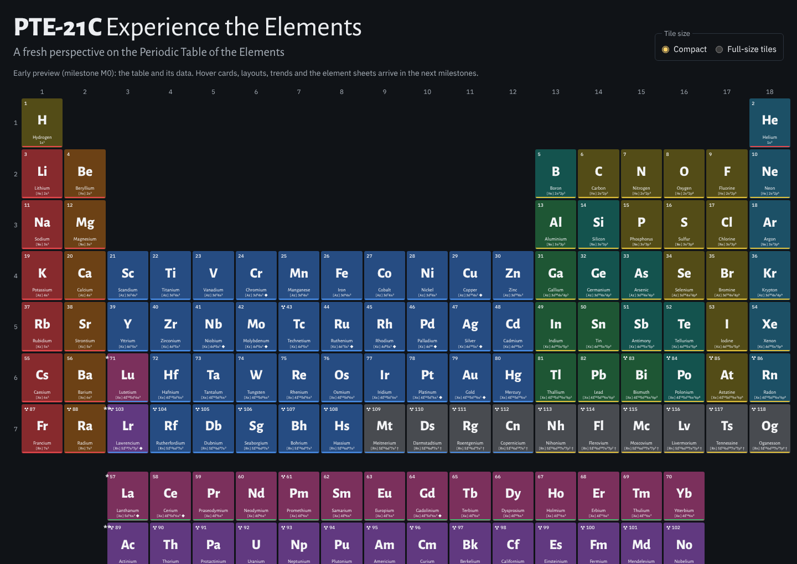
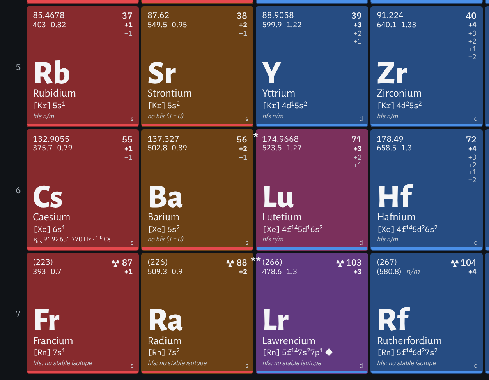
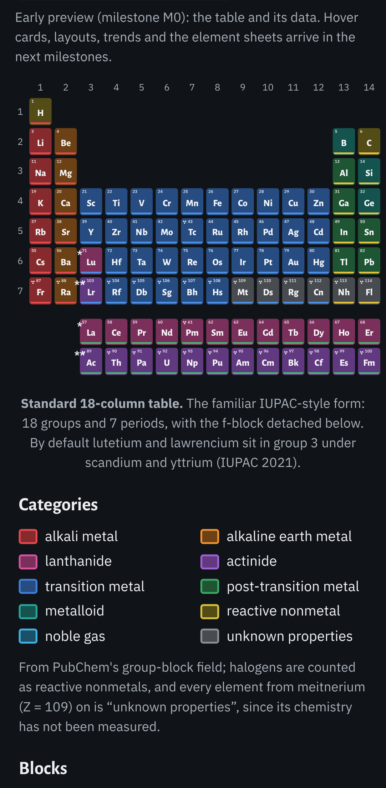

<!-- SPDX-License-Identifier: CC-BY-NC-SA-4.0 -->
# PTE-21C — Experience the Elements

*A fresh perspective on the Periodic Table of the Elements.*

A quantum-aware, photographic periodic table for the web. Every element gets its photographs, its electrons,
its nucleus and its place in the physics of measurement — and **every number on screen has a source**. Where
nothing has been measured, the table says so and says why, instead of showing a plausible guess.

> **Status: milestone M0 (skeleton).** The table renders all 118 elements from real, sourced data. Hover
> cards, the four layouts, trends, search and the element sheets with their eleven panels arrive in
> milestones M1–M4. See [STATUS.md](STATUS.md).

| Full-size tiles | Phone |
|---|---|
|  |  |

## What a tile shows

The fields of Robert Campion's reference table — atomic weight (or the mass number of the longest-lived
isotope), atomic number, first ionization energy, Pauling electronegativity, oxidation states with the common
ones in bold, symbol, name and the measured electron configuration (◆ where it breaks the Aufbau rule) — plus
the slot it lacks: the **ground-state hyperfine splitting** (caesium's 9 192 631 770 Hz defines the second),
or the physical reason an element has none.

## What it is not

- Not a chemistry calculator, not a molecule viewer, not a quiz or a game.
- No accounts, no server, no analytics, no telemetry, no AI chat. The page makes no request to any other site.
- Not a replacement for NIST, IAEA or PubChem: every value links back to where it came from.
- No invented values, and no prose copied from Wikipedia or other share-alike sources.

## Run it on a Mac

1. Install [Node.js](https://nodejs.org/) 22 or newer once, e.g. with Homebrew: `brew install node@22`.
2. Double-click **`PTE-21C.command`** in the project folder. The first time, macOS may refuse to open it:
   right-click the file, choose **Open**, then **Open** again. It installs what it needs (once) and opens the
   app in your browser. Close the Terminal window to stop it.

For developers: `npm install`, then `npm run dev | build | preview | test | test:e2e | lint | typecheck`.

## Where the data comes from

A Python pipeline in [`tools/`](tools/) downloads the sources (PubChem, NIST ASD and AWIC, IAEA LiveChart,
IUPAC CIAAW, CODATA), applies documented rules, validates the result against [`schema/`](schema/) and writes
[`public/data/`](public/data/). Run it with **`tools/pipeline.command`** (needs Python 3.11+ and internet).
[PROVENANCE.md](PROVENANCE.md) lists every source with its licence and retrieval date;
[tools/build-report.md](tools/build-report.md) lists every disagreement between sources. The design
decisions are in [docs/approach.md](docs/approach.md); [SPEC.md](SPEC.md) is the full specification.

## Contributing

Contributions are welcome under the project licence; see [CONTRIBUTING.md](CONTRIBUTING.md).

## Licence and credits

PTE-21C is free for non-commercial use and redistribution, including modified versions, under the same
licence. It is copyleft but not OSI-approved open source; commercial licences are available on request.

© Bietenhader (Fin). Code, layouts, curated data compilations, prose and design: [CC BY-NC-SA 4.0](LICENSE).
Data remain under their sources' terms ([PROVENANCE.md](PROVENANCE.md)); images are credited in
[CREDITS.md](CREDITS.md); third-party software and fonts keep their own licences ([NOTICE.md](NOTICE.md)).
